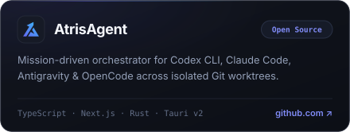
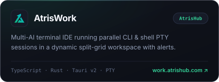
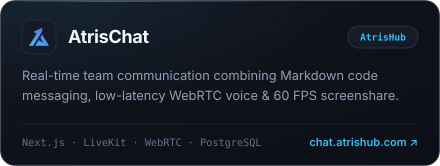
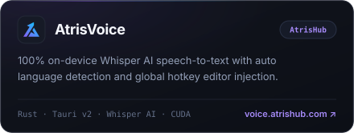
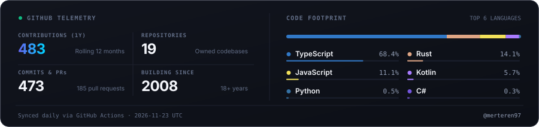

<!-- HERO MASTHEAD -->
<a href="https://atrishub.com" target="_blank" rel="noopener noreferrer">
  <picture>
    <source media="(prefers-color-scheme: dark)" srcset="./assets/hero-dark.svg" />
    <source media="(prefers-color-scheme: light)" srcset="./assets/hero-light.svg" />
    
  </picture>
</a>

 

<!-- REFINED CONNECT BAR -->

  <a href="https://atrishub.com" target="_blank" rel="noopener noreferrer">
    <picture>
      <source media="(prefers-color-scheme: dark)" srcset="./assets/btn-website-dark.svg" />
      <source media="(prefers-color-scheme: light)" srcset="./assets/btn-website-light.svg" />
      
    </picture>
  </a>&nbsp;
  <a href="https://www.linkedin.com/in/edip-mert-eren-232627160" target="_blank" rel="noopener noreferrer">
    <picture>
      <source media="(prefers-color-scheme: dark)" srcset="./assets/btn-linkedin-dark.svg" />
      <source media="(prefers-color-scheme: light)" srcset="./assets/btn-linkedin-light.svg" />
      
    </picture>
  </a>&nbsp;
  <a href="mailto:merteren1997@gmail.com">
    <picture>
      <source media="(prefers-color-scheme: dark)" srcset="./assets/btn-email-dark.svg" />
      <source media="(prefers-color-scheme: light)" srcset="./assets/btn-email-light.svg" />
      
    </picture>
  </a>

 

> **Software Engineer & Systems Architect** (Mechatronics Engineering, Kocaeli University) building software since **2008** — from industrial computer vision & real-time automation (`C# / .NET / Python`) to production backends (`Node.js / PostgreSQL`). Today I lead **[AtrisHub](https://atrishub.com)**, a local-first AI ecosystem across **Rust, Tauri v2, TypeScript, and WebRTC**.

 

#### `01` · Atris Ecosystem

<a href="https://github.com/merteren97/AtrisAgent" target="_blank" rel="noopener noreferrer">
  <picture>
    <source media="(prefers-color-scheme: dark)" srcset="./assets/card-atrisagent-dark.svg" />
    <source media="(prefers-color-scheme: light)" srcset="./assets/card-atrisagent-light.svg" />
    
  </picture>
</a>
<a href="https://work.atrishub.com" target="_blank" rel="noopener noreferrer">
  <picture>
    <source media="(prefers-color-scheme: dark)" srcset="./assets/card-atriswork-dark.svg" />
    <source media="(prefers-color-scheme: light)" srcset="./assets/card-atriswork-light.svg" />
    
  </picture>
</a>

<a href="https://chat.atrishub.com" target="_blank" rel="noopener noreferrer">
  <picture>
    <source media="(prefers-color-scheme: dark)" srcset="./assets/card-atrischat-dark.svg" />
    <source media="(prefers-color-scheme: light)" srcset="./assets/card-atrischat-light.svg" />
    
  </picture>
</a>
<a href="https://voice.atrishub.com" target="_blank" rel="noopener noreferrer">
  <picture>
    <source media="(prefers-color-scheme: dark)" srcset="./assets/card-atrisvoice-dark.svg" />
    <source media="(prefers-color-scheme: light)" srcset="./assets/card-atrisvoice-light.svg" />
    
  </picture>
</a>

 

#### `02` · Telemetry & Activity

<picture>
  <source media="(prefers-color-scheme: dark)" srcset="./assets/stats-dark.svg" />
  <source media="(prefers-color-scheme: light)" srcset="./assets/stats-light.svg" />
  
</picture>

 

<picture>
  <source media="(prefers-color-scheme: dark)" srcset="./assets/github-snake-dark.svg" />
  <source media="(prefers-color-scheme: light)" srcset="./assets/github-snake-light.svg" />
  
</picture>

 

Built with local-first principles · <a href="https://atrishub.com">atrishub.com</a>

